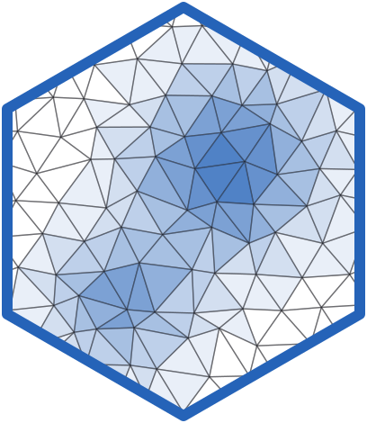

# inlaops 

<!-- badges: start -->
[](https://github.com/novica/inlaops/actions/workflows/R-CMD-check.yml)
[](https://CRAN.R-project.org/package=inlaops)
[](https://CRAN.R-project.org/package=inlaops)
[](https://doi.org/10.32614/CRAN.package.inlaops)
[](https://app.codecov.io/gh/novica/inlaops/branch/main)
[](https://novica.r-universe.dev/inlaops)
<!-- badges: end -->

Serve [inlabru](https://inlabru-org.github.io/inlabru/) models as versioned
REST APIs that answer with posterior uncertainty, not just a point estimate.

## Why

inlabru fits Bayesian spatial and latent Gaussian models well, but a fitted
model lives in an R session. Getting its predictions to the people and
systems that need them usually means re-running scripts by hand or exporting
static tables.

inlaops connects inlabru to [vetiver](https://vetiver.posit.co/), the
standard R tooling for model deployment. A `bru` fit can then be pinned with
version history, served over HTTP and packaged in a container like any
`lm()` or tidymodels fit. Each prediction carries the posterior mean, a 95%
credible interval and the posterior standard deviation.

For example, inlabru's
[gorilla nests article](https://inlabru-org.github.io/inlabru/articles/2d_lgcp_covars.html)
fits a log-Gaussian Cox process to nest locations in the Kagwene Gorilla
Sanctuary. Pinned and served with inlaops, that intensity surface
(`~ exp(field + Intercept)`) becomes an endpoint: a field team's app, or a
service in any language, sends coordinates to `/predict` and gets back the
expected nest density there, with its credible interval. Nobody on the
consuming side runs R. When the model is refitted on a new survey, the new
version is pinned and served, and the old versions stay available for
comparison and rollback.

## Installation

### From CRAN

``` r
install.packages("inlaops")
```

### From GitHub

``` r
# install.packages("pak")
pak::pak("novica/inlaops")
```

### From R-Universe

``` r
install.packages('inlaops', repos = c('https://novica.r-universe.dev'))
```

## Example

```r
library(inlabru)
library(vetiver)
library(pins)
library(plumber)
library(inlaops)

# config = TRUE keeps what the API needs for posterior sampling.
fit <- bru(
  y ~ Intercept(1) + x1 + x2,
  family  = "gaussian",
  data    = dat,
  options = bru_options(control.compute = list(config = TRUE))
)

v <- vetiver_model(fit, "my_model",
  metadata = list(pred_formula = "~ Intercept + x1 + x2")
)

board <- board_folder("model-store")
vetiver_pin_write(board, v)

pr() |> vetiver_api(v) |> pr_run(port = 8088)
```

From any HTTP client:

```sh
curl -X POST http://127.0.0.1:8088/predict \
  -H "Content-Type: application/json" \
  -d '[{"x1": 0.5, "x2": 1.0}]'
#> [{".pred":1.99,".pred_low":1.88,".pred_high":2.11,".pred_sd":0.058}]
```

Point-referenced spatial fits (`sf` / `sp` points, SPDE fields, LGCP
intensity surfaces) are served the same way: the request carries
coordinates. Polygon / areal fits are not served yet.

inlaops also includes `bru_reg()`, a parsnip engine for fixed-effects
inlabru models, and `bru_score()` for proper scoring rules (CRPS,
log-score) on held-out data.

<div class="pkgdown-hide">

<!-- Hidden on the pkgdown site, which has the articles in its navbar. -->

## Learn more

The [articles](https://novica.github.io/inlaops/articles/) cover serving,
versioning, containers, Posit Connect, spatial and LGCP models, the parsnip engine and
scoring rules.

</div>
